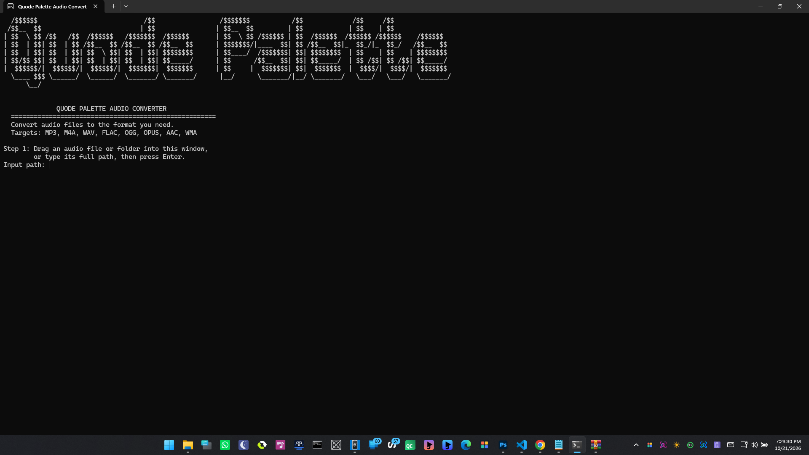
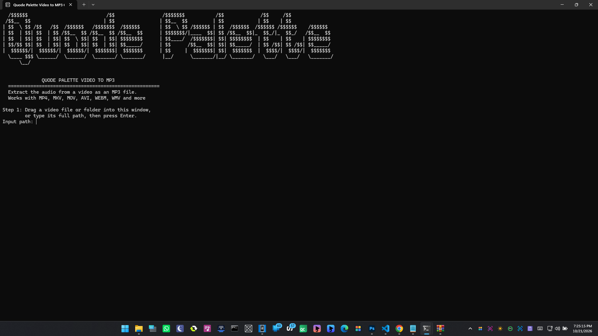

# Quode Palette Converters

Four simple converters for Windows. Drop in a file, pick what you want, done. No accounts, no ads, no uploading anything. Everything runs on your own PC.

| Tool            | What it does                                                 | Engine |
| --------------- | ------------------------------------------------------------ | ------ |
| Audio Converter | Converts between MP3, M4A, WAV, FLAC, OGG, OPUS, AAC and WMA | FFmpeg |
| Video Converter | Converts to MP4, MKV, WEBM, MOV, AVI and GIF                 | FFmpeg |
| Image Converter | Converts to PNG, JPG, WEBP, BMP, TIFF, GIF and ICO           | Pillow |
| Video to MP3    | Pulls the audio out of a video as an MP3                     | FFmpeg |

Each tool works on one file or a whole folder, and none of them overwrite your files unless you ask.

<table>
  <tr>
    <td width="50%" align="center">
      
       
      <b>Audio Converter</b>
       
      Convert common audio formats with FFmpeg
    </td>
    <td width="50%" align="center">
      
       
      <b>Video Converter</b>
       
      Convert common video formats with FFmpeg
    </td>
  </tr>
  <tr>
    <td width="50%" align="center">
      
       
      <b>Image Converter</b>
       
      Convert common image formats with Pillow
    </td>
    <td width="50%" align="center">
      
       
      <b>Video to MP3 Converter</b>
       
      Extract MP3 audio from video files with FFmpeg
    </td>
  </tr>
</table>

## Download

Go to the **Releases** page and download the latest zip. Unzip it anywhere and double-click the program you want.

Keep everything in the folder together. The audio, video and video to MP3 tools use the `ffmpeg.exe` that comes in the zip but the image tool does not need it.

Windows 10 or 11, 64-bit.

## A note about the Windows warning

The programs are not code signed, so the first time you run one, Windows SmartScreen may say "Windows protected your PC". Click **More info**, then **Run anyway**. It only asks once per file.

## Credits

Audio and video conversion is powered by [FFmpeg](https://ffmpeg.org/). The bundled build comes from [BtbN's builds](https://github.com/BtbN/FFmpeg-Builds) and is licensed under the GPL. Image conversion uses [Pillow](https://python-pillow.org/).

## License

Released under the [PolyForm Noncommercial License 1.0.0](LICENSE). You are free to use, modify and share it for personal, educational and other noncommercial purposes. For commercial use, please get in touch.
[Email Us](mailto:hello@quodepalette.com)
